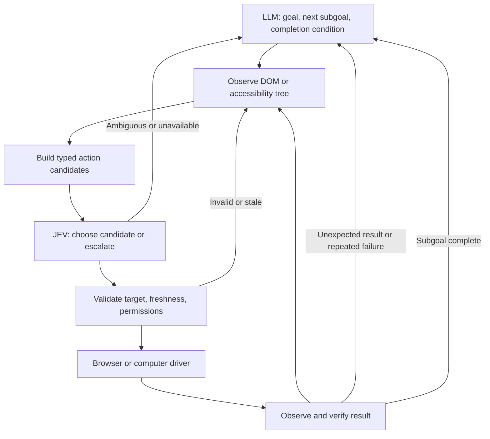

# Wiring TypeSafe JEV with an LLM for browser and computer use

I’d wire **the LLM as planner, JEV as a bounded decision engine, and the browser/computer driver as executor**. The biggest potential gain is reducing full LLM turns during routine interaction while keeping recovery intelligent.

You already have the foundation in `packages/opencode/src/tool/jev-decide.ts` and `packages/opencode/src/jev/controller.ts`. I’d evolve that prototype into this loop:



## 1. Let the LLM define a small, concrete subgoal

For example:

> “Open Settings, then select Appearance. Complete when the Appearance heading is visible.”

The LLM supplies the intent, allowed changes, and completion condition. It returns for unexpected dialogs, ambiguous screens, route changes, or failed actions.

JEV handles bounded questions such as “which of these visible controls advances this subgoal?” Its typed choice interface fits this division; type safety still doesn’t establish that a decision is correct. [JEV evaluation paper](https://arxiv.org/abs/2609.37647)

## 2. Have JEV select a complete action candidate

Today, your controller chooses `action` and `target` independently. That permits incompatible combinations, such as typing into a button.

Instead, code should construct valid candidates:

```ts
type Candidate =
  | { id: string; kind: "click"; target: TargetRef }
  | { id: string; kind: "fill"; target: TargetRef; value: string }
  | { id: string; kind: "scroll"; target: TargetRef; direction: "down" | "up" }
  | { id: string; kind: "observe" }
  | { id: string; kind: "escalate" }
```

JEV returns **one candidate ID**. The executor resolves the original object locally. Labels describe candidates; they never become executable addresses. Fill values come from the authorized task or LLM plan.

Use Effect Schema for runtime validation and derive TypeScript types from those schemas.

## 3. Give browser and computer use the same observation contract

| Shared information | Browser adapter | Computer adapter |
|---|---|---|
| Surface identity | Tab, frame, navigation revision | PID, window, snapshot |
| Target reference | Driver-issued DOM reference | AX element token |
| Control description | Role, name, value, enabled state | Role, label, value, supported actions |
| Verification evidence | DOM read-back, URL, heading | AX read-back, window state, screenshot |

Each candidate must retain its observation identity. Before executing, validate that the target still exists, supports the action, and belongs to the intended surface.

For canvas or poorly exposed interfaces, return to the vision-capable LLM with a screenshot. JEV can choose among grounded candidates once those exist.

## 4. Put the short loop in code

Calling `jev_decide` as an extra LLM tool on every step adds round trips. I’d introduce a bounded `ui_run` tool that performs:

**observe → build candidates → JEV → validate → execute → verify**

It returns on completion, uncertainty, cancellation, permission requirements, or a configurable step/time limit. Use one shared controller for both adapters.

Your running app is the Electron desktop, so integrate orchestration through the **V1 tool path**. Also verify exact `owned_tools` exposure: registration and permission alone do not make a tool available to the agent.

## 5. Fix these prototype gaps first

- Replace label-string targets with candidate IDs bound to observations.
- Preserve separate action and target evidence if retaining the existing protocol.
- Treat `success` as advisory; completion requires observed evidence.
- Mark truncated observations explicitly. The current 60-control cap can hide the desired target.
- Make memo identity cover the complete candidates, observation revision, model, and decision settings.
- On timeout or invalid verdict, return control to the LLM with a reason.

## Proposed rollout

Start with JEV choosing targets while the LLM chooses actions. Then enable the autonomous short loop for reversible navigation and form filling. Expand only after comparing task completion, wrong actions, LLM turns, latency, and recovery rate against the current loop.

The strongest opportunity is **several verified UI steps per LLM planning turn**. Whether that improves speed and cost needs measurement on your actual browser and desktop workflows.

## Role assignment (2026-10-03)

In this deployment the proposal's LLM planner role is played by the `computer-aid` subagent (the CUA operator), with the brain as orchestrator. JEV stays the bounded decision engine: it picks the categorical next step from a capped control table, not the plan.
